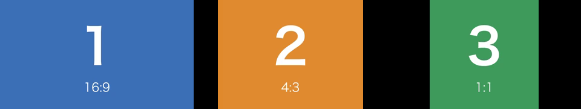
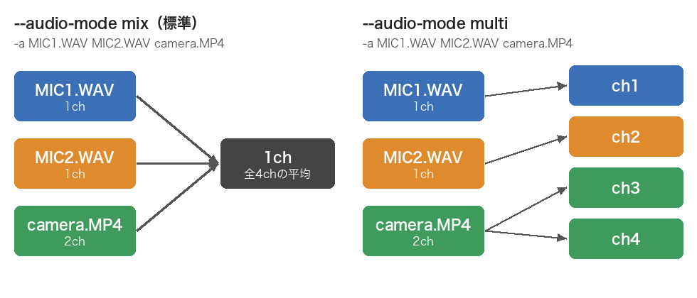

# 会話収録メディアの同期と合成

同じ会話を収録した複数のカメラ映像とマイク音声を、同期して切り出し、並べて1本の動画にまとめるツールです。ブラウザで操作する GUI と、コマンドラインのスクリプトがあります。

- **GUI（`app.py`）**: ブラウザで同期・合成・切り抜きを操作します。サーバー上で動かし、SSH 越しに手元のブラウザから使うこともできます。
- **`sync_media.py`**: 録音されている同期用の機械音と、会話音声の相互相関で全ファイルを揃え、同じ時刻から切り出します。入力はすべて等価に扱います。
- **`compose_media.py`**: 同期済みのファイルを並べて、1本の動画（または WAV）にまとめます。
- **`trim_media.py`**: 複数のファイルから、同じ時間の範囲を切り抜きます。

[mic-array-recorder](https://github.com/Taiga-Mori/mic-array-recorder) で録音することを想定しています。mic-array-recorder は、録音開始から指定した秒数後にスピーカーから同期用の機械音（1318.51 Hz とその2倍・3倍の倍音、なめらかに減衰する音）を鳴らします。この音がマイクアレイだけでなく、同じ部屋のカメラやピンマイクにも録音されるので、それを目印に全ファイルを揃えます。`sync_media.py` の同期音検出の標準設定（`--beep-frequency 1318.51`、倍音の比率 1 : 0.45 : 0.20）は、この機械音に合わせてあります。ほかの方法で同期音を鳴らす場合は、`--beep-frequency` で基本周波数を指定してください（約2.6 kHz まで）。

## インストール

Python 3.10 以降が必要です。

```bash
python3 -m venv venv
source venv/bin/activate          # Windows: venv\Scripts\activate
pip install -r requirements.txt
```

ffmpeg と ffprobe も必要です。`ffmpeg/mac`、`ffmpeg/win`、`ffmpeg/AMD`（Linux）に置いたものがあればそれを使い、なければ PATH から探します。

macOS・Windows・Linux で動く想定です（動作を確認したのは macOS のみ）。映像のエンコードには、使えるハードウェアエンコーダ（Mac の VideoToolbox、NVIDIA の NVENC、Intel の QSV、AMD の AMF）を自動で選び、使えなければ CPU のエンコーダを使います。使えるかどうかは、実行時に1フレームだけ試しにエンコードして判定します。

更新は `update.sh`（Windows は `update.bat`）で行います（`git pull` を実行します）。

## GUI の使い方

```bash
./start.sh                 # Windows: start.bat（どちらも python app.py と同じ）
./start.sh --port 8600     # ポートを指定する場合（省略時は8501から空いているポートを自動で使用）
```

起動するとブラウザが開きます（開かない場合は、表示された `http://localhost:8501` などを開いてください）。GUI は Python の標準ライブラリだけで動く小さな Web サーバー（`web_server.py`）と、ブラウザで表示する画面（`web/`）でできていて、追加のライブラリは要りません。サーバーは手元のパソコンからの接続（localhost）だけを受け付けます。

### SSH 越しに使う

録音のあるサーバーで GUI を起動し、手元のブラウザから操作できます。

```bash
ssh -L 8501:localhost:8501 user@server     # 手元で実行（ポートを転送）
cd mic-array-synchronizer && ./start.sh    # サーバーで実行（SSH 越しではブラウザは自動で開きません）
```

手元のブラウザで `http://localhost:8501` を開きます。処理はサーバー上の別のプロセスで動くので、**ブラウザを閉じても、SSH が切れても止まりません**。ページを開き直すと、実行状況と結果がまた表示されます（実行の記録は `~/.mic-array-synchronizer/jobs/` に残ります）。GUI のサーバー自体も切断後に動かし続けたい場合は、`tmux` の中で `start.sh` を実行してください。

### 画面

同期・合成・切り抜きの3つのタブがあり、どれも左が設定、右が実行状況です。

- **ファイルの指定**：「ファイルを追加…」で、サーバー上のフォルダを移動しながらファイルを選びます（複数選択可。フォルダでの並び順で追加されます）。リストの行はドラッグか ↑↓ で並べ替えられます。
- **同期タブ**
  - 録音・録画ごとに1行です。分割されたファイルは、その行の「分割ファイルを追加」で録画順に足します（`+` でつながります）。
  - 出力フォルダとオプションを指定して「同期を開始」を押します。
- **合成タブ**：映像を追加・並べ替えすると、配置のイメージ図（番号は映像の順番）がその場で変わります。「実際の1フレームを表示」で完成イメージを確認してから、「合成を開始」を押します。
- **切り抜きタブ**：切り抜くメディアと範囲（開始・終了か長さ・名前）を入れて、「切り抜きを開始」を押します。
- **実行状況**：実行履歴、進み具合、実行したコマンド、ログが表示されます。「中止」で処理（ffmpeg を含む）を止められます。
  - 同期が終わると `report.json` の内容（検出の信頼度、同期音の位置、相関による補正量、ドリフト、相関が取れたペアの数）が表で表示されます。⚠ の付いたファイルは sync_check.wav で確認してください。「合成タブに入力」「切り抜きタブに入力」で、同期した出力をそのまま次の作業に使えます。
  - 出力ファイルは「▶ 再生」でブラウザ上で再生できます（HEVC の映像は、Safari か、ハードウェアが対応した Chrome / Edge で再生できます）。「保存」で手元にダウンロードできます。
- 入力した内容は、このブラウザに保存されます（ページを開き直しても残ります）。
- 内部では `sync_media.py` / `compose_media.py` / `trim_media.py` をそのまま実行しているので、結果はコマンドラインで実行した場合と同じです。

## 同期（sync_media.py）

```bash
python3 sync_media.py -o /Volumes/TEIDAN/sync \
  A/GX010310.MP4 B/GX010310.MP4 C/GX010301.MP4 E/GX010308.MP4 \
  micarray/0_120_240.wav pin/MIC1.WAV pin/MIC2.WAV pin/MIC3.WAV
```

まず `--analyze-only` を付けて実行し、`report.json` で検出結果を確認するのがおすすめです（数分で終わります）。

### 分割されたファイル

1台の機材の録画・録音が複数のファイルに分かれている場合は、録画順に `+` でつないで1つの入力として指定します。

```bash
python3 sync_media.py -o out \
  A/GX010310.MP4+A/GX020310.MP4+A/GX030310.MP4 \
  B/GX010311.MP4+B/GX010312.MP4 \
  pin/MIC1.WAV micarray/0_120_240.wav
```

- カメラの自動分割（GoPro の `GX01…` → `GX02…` など）でも、機材トラブルで止まって録り直した場合でも、同じように指定します。どのファイルをつなぐかは自動では判断しないので、指定してください。
- 1つ目のファイルは、これまでどおり同期音で位置を決めます。2つ目以降のファイルは、**同じ時間を録っているほかの機材の音声**との相互相関で位置を決めます。手順は次のとおりです。
  1. 大まかな位置：タイムコードがあれば「前のファイルからの経過時間」の前後3秒を探します。なければ、前のファイルの終わり以降のすべてを探します（2 kHz の GCC-PHAT）。
  2. 精密な位置：ファイル全体に区間を取って、16 kHz の GCC-PHAT で詰めます。会話音声の相関が取れた機材を優先し、精密な相関が成立しない候補は別の参照機材で試します。
- 前のファイルとの間隔が `--contiguous-tolerance`（標準0.1秒）以内なら「連続」とみなし、前のファイルの直後にそのままつなぎます。自動分割はこの扱いになり、分割していない1本のファイルと同じ結果になります。
- 間隔がある場合、その区間は**黒画面と無音で埋めて**、機材ごとに1本の `_sync` ファイルにします。映像と音声の開始時刻・長さが違う場合もトラックごとの時刻を保持し、不足する部分を埋めます。そのため全ファイルの時間軸は揃ったままで、`compose_media.py` もそのまま使えます。
- 相関で位置を決められない場合（同じ時間をほかの機材が録っていない、など）は、タイムコードで配置して警告を出します。タイムコードもない場合はエラーになるので、`--segment-gap FILE=SECONDS` で前のファイルとの間隔を指定してください（連続なら `0`）。
- 位置と間隔は `report.json` の各入力の `segments`（`output_start_seconds`、`gap_before_seconds`、`method` など）に記録されます。`method` は `contiguous`（連続）、`correlation`（相関で配置）、`timecode-only`（タイムコードだけで配置。要確認）、`manual`（指定どおり）のいずれかです。
- 2つ目以降のファイルは開始位置で揃え直すので、ドリフトによるずれは再開するたびにリセットされます。
- `--fast-copy` は、分割されたファイルには使えません（つなぐために再エンコードが必要なため）。
- 合成データ（隙間 41〜63 秒、ドリフト ±40 ppm）で試したところ、間隔の推定誤差は 2〜5 ms、つなぎ目の直後のずれは ±2 ms 程度でした。

### 出力

- `<元のファイル名>_sync.mp4` / `_sync.wav`: 元の形式に関係なく、映像のあるファイルは MP4（映像は HEVC など、音声は AAC）、音声だけのファイルは WAV で出力します。WAV は、元が PCM ならビット深度をそのまま保ち、FLAC などの可逆圧縮は 24bit、MP3 や AAC などの非可逆圧縮は 16bit の PCM にします。同期音の `--pre-roll`（標準50 ms）前から始まり、標準では最も早く終わる機材に合わせて終わります。`--duration-mode longest` では最も遅く終わる機材に合わせ、不足分を黒画面・無音で埋めます。全ファイルが同じ長さになります。分割された入力は、1つ目のファイルの名前で出力します。名前が重複する場合は、フォルダが違えば親フォルダ名を前に（例: `A_GX010310_sync.mp4`）、同じフォルダなら元の拡張子を後ろに（例: `cam.MOV` と `cam.MTS` → `cam_MOV_sync.mp4`、`cam_MTS_sync.mp4`）付けます。
- `sync_check.wav`: 全入力の全音声チャンネルを、入力した順に1つの多チャンネル WAV（24bit、入力の最高サンプルレート）にまとめたものです。同期精度の確認用で、どのチャンネルがどの入力かは `report.json` の `check_wav.channels` に記録されます。
- `report.json`: 同期音の検出結果、ペアごとの相関結果、ドリフト量、切り出し位置などです。

### 同期の方法

1. **同期音の検出**: 各ファイルの冒頭（標準600秒）から同期音を探し、立ち上がりを求めます。
   - 基本周波数・2倍音・3倍音のそれぞれが、すぐ近くの周波数（±120〜240 Hz）よりどれだけ突出しているかを測り、3つをまとめた値（幾何平均）を0.4秒平均して候補を選びます。大きな声や物音は近くの周波数も大きいので、倍音のない短い純音は2倍音・3倍音が突出しないので、どちらも点数が低くなります。録音された同期音は、スピーカーや部屋の影響で2倍音が基本波より強いことが多いので、倍音の比率は条件にしません。
   - 同期音の直前（0.05〜0.25秒前）は静かなはずなので、そうなっている候補を優先します。直前が同期音より12 dB以上静かなら点数はそのまま、同じ大きさなら点数を0.6倍にします。満たさなくても候補からは外しません。
   - 同期音は録音の冒頭にあるはずなので、前のほうにある候補も優先します。探索範囲の先頭では点数はそのまま、末尾（標準では600秒）では0.8倍になるよう、時間とともにゆるやかに下げます。これも優先するだけで、後ろの候補がはっきり強ければそちらを選びます。分割ファイルの2つ目以降は同期音を探さず相関で配置するので、影響しません。
   - 立ち上がりは、同期音の成分が最大値の -40 dB 以上で50 ms中45 ms続き始めた位置です。雑音抑制で非常に静かな録音（スマートフォンなど）で、同期音の前のかすかな雑音に反応しないようにするためです。
2. **チャンネルの選択**: 多チャンネルの音声では、同期音の後の20秒でチャンネル同士の相互相関を取り、時刻が揃っている（±1 ms）チャンネルが最も多いグループだけを解析に使います。たとえば ReSpeaker 型マイクアレイの ch1 は DSP 処理済みで約62 ms遅れるので除外され、無音の ch6 も除外されます。2チャンネルで食い違う場合のように多数派が決まらないときは、全チャンネルを候補にします。チャンネル同士のずれは `report.json` の `channel_lags_ms` に記録されます。
3. **タイムコード**: タイムコードを持つ映像では、「タイムコード＋同期音の位置」がカメラ間で一致するか確認します。同期音の検出が曖昧なファイルは、タイムコードから予想される位置の周辺だけを探し直します。
4. **相互相関**: 同期音から5秒後以降、共通区間全体から60秒間隔で20秒ずつ区間を取り、すべてのファイルペアで GCC-PHAT によってずれを測ります。録音機のクロックずれ（ドリフト）は時間に比例するので、ペアごとにずれの推移を直線で当てはめ、同期音の時点の値をそのペアのずれとします。全ペアの値を最小二乗法でまとめ、ほかのペアと矛盾するペアは除外します。全体の基準位置は、同期音の立ち上がりの平均です。
5. **相関が取れないファイルの探し直し**: 相関が1ペアも取れなかったファイルは、同期音の位置を相関の探索範囲（`--max-lag-ms`）以上に間違えた可能性があります。そのファイルの1分間の音声を、相関が取れたほかの録音の全体から探して（2 kHz の GCC-PHAT）、同期音があるはずの位置を求め、その前後2秒で同期音を探し直します。そのあと相互相関をやり直します。見つからなければ会話の位置だけで置き（`confidence` が `conversation-only`）、警告を出します。
6. **同一クロックの検出**: サンプルレートとサンプル数が一致し、互いのドリフトがほぼ0のファイル（同じ録音機のピンマイクなど）は、同じ位置で切り出します。話者ごとに音の届き方が違うことで、もともと揃っている同期がずれるのを防ぐためです。

同期音の部分だけを相関させないのは、純音だと約0.76 ms（1318 Hz の1周期）ごとに似た相関ピークが出て、取り違えやすいためです。

### 主なオプション

- `--pre-roll`: 同期音より何秒前から残すか（標準 `0.05`）。
- `--duration-mode shortest|longest`: 出力を最短の入力に揃える（標準 `shortest`）か、最長に揃えるかを選びます。`longest` は短い入力の末尾を黒画面・無音で埋めます。分割ファイルの隙間も長さに含みます。`--fast-copy` とは併用できません。
- `--search-start` / `--search-seconds`: 同期音の探索範囲（標準は先頭から600秒）。
- `--manual-beep FILE=SECONDS`: 自動検出できないファイルについて、人が確認した同期音の秒数を指定します。FILE はファイル名・パス・入力番号（1始まり）のどれでも構いません。複数回指定できます。
- `--corr-window` / `--corr-interval`: 相関区間の長さと間隔（標準 20 秒 / 60 秒）。
- `--max-lag-ms` / `--max-drift-ppm`: 相関で探すずれの範囲。同期音の時点で ±20 ms、そこから時間とともに 200 ppm の割合で広げます。
- `--timecode-tolerance`: タイムコードと同期音の位置の許容差（標準 0.5 秒）。
- `--segment-gap FILE=SECONDS`: 分割された2つ目以降のファイルについて、前のファイルとの間隔を指定します（連続なら `0`）。複数回指定できます。
- `--contiguous-tolerance`: 分割ファイルの間隔がこの秒数以内なら連続として扱います（標準 0.1 秒）。
- `--video-encoder`: 映像を切り出すときのエンコーダ。映像はフレーム位置で正確に切るため、再エンコードします。
  - `auto`（標準）: 使えるハードウェアの HEVC エンコーダ（20 Mbps）を使い、なければ `libx264` を使います。Mac（M3）の `hevc_videotoolbox` では、1080p で実時間の約5倍の速さでした。GoPro の 1080p 映像で計測したところ、元映像との差（VMAF 約97）は libx264 CRF 18（VMAF 約96）と同等以上でした。
  - `hevc_videotoolbox` / `hevc_nvenc` / `hevc_qsv` / `hevc_amf`（20 Mbps）、`h264_*`（30 Mbps）: エンコーダを固定したいとき。
  - `libx264`（CPU、CRF 18）: 1080p で実時間とほぼ同じ速さです。
- `--video-bitrate`: ハードウェアエンコーダのビットレート（例: `20M`）。
- `--fast-copy`: 再エンコードせずに高速に切り出します。ただし開始位置はキーフレーム単位になります。

### 注意

- **ドリフトは補正しません。** 開始位置を揃えるだけなので、終盤ではドリフトの分だけずれます。2026年10月7日の収録では、30分で最大約85 msずれました（GoPro どうしで最大約45 ppm）。各ファイルのドリフト量（全ファイル平均に対する ppm）と終端でのずれは、`report.json` の `drift_ppm` / `drift_at_end_ms` で確認できます。同期音の後の長さが短く（約85秒未満）、相関区間が3つ取れないファイルは、ドリフトを推定せず `null` になります。
- 実行後に警告が出たファイル（相関が1ペアも取れなかったもの、タイムコードや会話の相関だけで位置を決めたもの）は、`sync_check.wav` で確認してください。
- 音源と各マイクの距離の違いによる到達時間差（数 ms）は残ります。相関で求めるずれは、会話全体での平均的なずれです。
- 入力するファイルの収録日が揃っているか確認してください。別の日の録音が混ざると、相関が1ペアも取れず警告が出ます。
- **検証の状況**: 正解が分かっている合成データでは、ファイル間の誤差は ±数µs でした。分割ファイルの扱いは合成データでのみ確かめています。実データ（2026年10月7日の収録）では、ペアの残差は 0.5 ms 以下でした。ただしこの実データは、手法やしきい値を決める開発にも使ったものです。開発に使っていない収録データでの検証はまだです。

## 合成（compose_media.py）

同期済みのファイルを1本の動画にまとめます。ファイルの時間はずらしません。

```bash
python3 compose_media.py --layout row \
  -v C_GX010301_sync.mp4 B_GX010310_sync.mp4 A_GX010310_sync.mp4 \
  -a MIC1_sync.wav MIC2_sync.wav MIC3_sync.wav \
  --codec hevc --video-bitrate 8M \
  -o composite.mp4
```

この例では、左から C・B・A（右から A・B・C）の順に横一列に並べ、ピンマイク3本をミックスしたモノラル音声を付けます。

- `-v`: 映像にするメディア。音声だけのファイルを指定した場合は、警告を出して使いません。
- `-a`: 音声にするメディア。動画ファイルも指定できます。
- `-v` を指定しない場合は WAV で出力します。
- 出力の長さは一番長い入力に合わせます。短い映像は最後のフレームで止まり、短い音声の後ろは無音になります。

### 配置（`--layout`）

`-v` に指定した順に、左上から右へ、行が埋まったら次の行へと並べます。下の図は実際の出力で、数字が `-v` に指定した順番です（`docs/make_figures.py` で作り直せます）。

**`--layout row`（横一列）**: `-v 1.mp4 2.mp4 3.mp4`


**`--layout column`（縦一列）**: `-v 1.mp4 2.mp4 3.mp4`


**`--layout grid`（なるべく正方形。標準）**: `-v 1.mp4 2.mp4 3.mp4 4.mp4 5.mp4`。列数は「入力数の平方根を切り上げた数」で、余ったマスは黒になります。


右から A・B・C の順にしたい場合は、`-v C.MP4 B.MP4 A.MP4` のように左から並べたい順で指定します。

### 縦横比の違う映像（`--cell-size`）

1画面の大きさは、最初の映像の大きさ（`--cell-size` で指定した場合はその大きさ）に揃えます。縦横比が違う映像は縮小して中央に置き、余白は黒にします。下の図は、16:9・4:3・1:1 の映像を `--layout row` で並べたものです。



### 音声（`--audio-mode`）



- `mix`（標準）: 全チャンネルを平均した1ch にします。音割れを防ぐため平均にしているので、3本なら1本あたりの音量は約10 dB下がります。
- `multi`: 全チャンネルを、`-a` に指定した順に並べます。複数チャンネルのファイルは、そのチャンネルを順番どおりに入れます。MP4 の AAC は8chまでなので、それを超える場合は出力を `.mov` か `.mkv` にします（音声は PCM で格納）。

### 映像の形式・解像度・ビットレート

それぞれ、入力のままにするか、変換・圧縮するかを選べます。

| オプション | 標準（`source`） | 変換・圧縮する場合 |
|---|---|---|
| `--codec` | 最初の映像と同じ形式 | `hevc` / `h264` |
| `--cell-size` | 最初の映像の大きさ | `WxH`（例: `640x360`）。縦横比が違う映像には黒帯が入ります |
| `--video-bitrate` | 入力のビットレートの合計（縮小した場合はその分減らします） | `8M` など、出力全体の値 |

- `--encoder auto`（標準）は、ハードウェアエンコーダ（VideoToolbox / NVENC / QSV / AMF）が出力の大きさで使えればそれを使い、使えなければ CPU（libx265 / libx264）を使います。`hardware` / `software` で固定することもできます。
- **H.264 のハードウェアエンコーダは、多くの場合幅4096ピクセルまで**です（Mac で確認。NVIDIA も同様の仕様）。それを超える大きさ（例: 1080p を3つ並べた 5760×1080）を H.264 にすると CPU でのエンコードになり、時間がかかります。HEVC ならハードウェアで扱えます。
- 速度の目安（M3）: 1080p×3（5760×1080）を HEVC 8 Mbps で作ると、実時間の約2倍の速さでした（31分の素材で約15分）。

### プレビュー

端末から実行すると、合成の前に完成イメージの静止画を表示し、「この配置で実行しますか？ [y/N]」と確認します。画像は保存しません。表示する時刻は `--preview-at 秒` で変えられます（標準は中央）。確認を省くときは `--no-preview` を付けます（端末以外から実行したときは常に省略されます）。

### 再生の互換性

HEVC は、Mac・iPhone・VLC なら問題なく再生できます。Windows 標準のアプリや ELAN などで使う場合は、Microsoft Store の「HEVC ビデオ拡張機能」などが必要になることがあります。配布先の環境が分からない場合は、H.264 の方が安全です。

## 切り抜き（trim_media.py）

複数のファイルから、同じ時間の範囲を切り抜きます。同期済みのファイルに使えば、全機材の同じ場面がそろいます。

```bash
python3 trim_media.py -o clips \
  -r 10:00-12:30 -r 25:00+90=task2 \
  sync/TK002/*_sync.mp4 sync/TK002/*_sync.wav
```

- `-r` / `--range`: 切り抜く範囲です。複数回指定できます。
  - `開始-終了`（例: `10:00-12:30`）か `開始+長さ`（例: `25:00+90`）で指定します。
  - 時刻は秒（`600.5`）か `[時:]分:秒`（`10:00`、`1:02:03.5`）で書きます。
  - 後ろに `=名前` を付けると、出力ファイル名にその名前を使います。付けなければ時刻を使います（`HHMMSS-HHMMSS`）。
- 出力は `<元のファイル名>_<範囲の名前>.mp4`（映像）か `.wav`（音声）です（例: `GX010044_sync_001000-001230.mp4`、`GX010044_sync_task2.mp4`）。名前が重なる場合の付け方は同期と同じです。
- 映像は再エンコードして、フレーム単位で正確に切ります。形式・ビットレート・エンコーダは、合成と同じく `--codec`、`--video-bitrate`、`--encoder` で選べます（標準は入力と同じ形式・ビットレート、使えればハードウェアエンコーダ）。音声はサンプル単位で正確に切ります。
- `--fast-copy`: 映像を再エンコードせずに速く切り抜きます。開始位置はキーフレーム単位になるので、指定より少し前から始まります。
- 範囲がファイルの終わりを超える場合は、警告を出して終わりまでを切り抜きます。開始がファイルの長さを超える場合はエラーになります。
